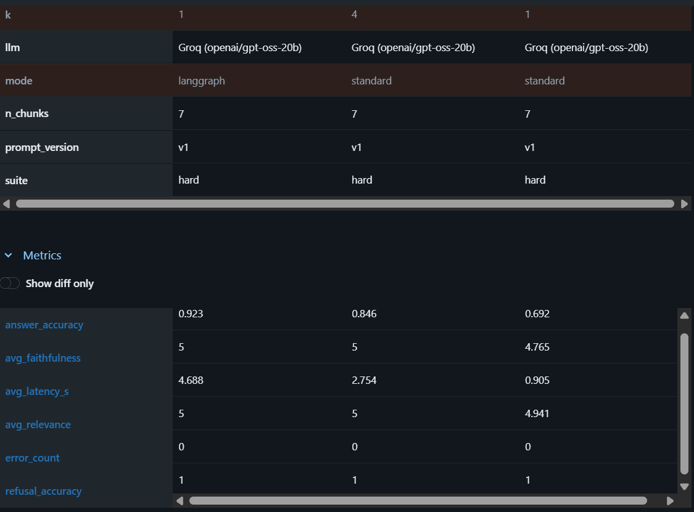

# Multi-PDF Chatbot (RAG)

Upload one or more PDFs, click **Process PDFs**, and ask questions. Answers come only from your documents.

**Stack:** Streamlit, LangChain, FAISS, SentenceTransformers (`all-MiniLM-L6-v2`), Groq (hosted) or Ollama (local), LangGraph.

## Features

- Chat over multiple PDFs with source chunks shown for every answer.
- Two modes:
  - **Standard RAG:** retrieve the top chunks, then answer from them.
  - **Self-Correcting RAG (LangGraph):** a grader checks whether the retrieved context is enough, and if not, the search is widened once before answering.
- Refuses questions that are not answered in the documents.

## Run locally

```bash
pip install -r requirements.txt
streamlit run app.py
```

Set `GROQ_API_KEY` in a `.env` file to use Groq. Without it, the app uses a local Ollama model.

## Testing & Evaluation

[](https://github.com/Jaya2107/multiple-pdf-chat/actions/workflows/tests.yml)

This project has an automated test suite, a CI pipeline, and an evaluation harness that measures answer quality of the RAG pipeline.

### Automated tests (pytest)

| Layer | Tool | What it checks |
|---|---|---|
| UI tests | Playwright | page load, upload, error handling, full "upload → process → chat enabled" flow |
| UI cross-check | Selenium | page title, both RAG modes visible, warning when no PDF is uploaded |
| Unit tests | pytest | self-correcting LangGraph logic (retry once, fail-open when the grader crashes), using a fake LLM and fake vector store, so no API key is needed |
| Eval code tests | pytest | the scoring code itself (keyword match, judge-reply parsing, error handling) |

Two end-to-end tests need a real LLM (answer comes from the document, out-of-scope question is refused). They are skipped by default and run only when `RUN_LLM_TESTS=1` is set.

```bash
pip install -r requirements.txt -r requirements-test.txt
playwright install chromium
pytest -v
```

### CI/CD (GitHub Actions)

Every push and pull request runs the test suite on a fresh Ubuntu runner (`.github/workflows/tests.yml`): install dependencies, install the Playwright browser, run `pytest`. The Selenium tests use a local `chromedriver` if present and let Selenium Manager find the driver on CI.

### Evaluation harness (LLM-as-judge + MLflow)

`evals/run_eval.py` runs a golden dataset through the RAG pipeline and logs parameters, metrics and per-question results to MLflow.

- **Keyword scoring:** an answer is correct if it contains the expected facts, or if it refuses when the question is out of scope.
- **LLM-as-judge:** a second LLM call scores faithfulness (is the answer supported by the retrieved context) and relevance, from 1 to 5.
- **Two suites:**
  - `easy`: 14 questions over a short fact sheet.
  - `hard`: 17 questions over a longer document with a look-alike neighbouring country, multi-step questions (arithmetic, combining two facts), paraphrased questions, and questions whose answer is not in the document.

```bash
pip install mlflow
python -m evals.run_eval --suite hard --chunk-size 300 --chunk-overlap 50 --k 1 --judge
python -m evals.run_eval --suite hard --chunk-size 300 --chunk-overlap 50 --k 4 --judge
python -m evals.run_eval --suite hard --mode langgraph --chunk-size 300 --chunk-overlap 50 --k 1 --judge
mlflow ui --backend-store-uri sqlite:///mlflow.db
```

### Results (hard suite, Groq `openai/gpt-oss-20b`)

| Config | Answer accuracy | Refusal accuracy | Avg faithfulness | Avg latency |
|---|---|---|---|---|
| Standard RAG, k=1 | 0.692 | 1.0 | 4.77 | 0.9 s |
| Standard RAG, k=4 | 0.846 | 1.0 | 5.0 | 2.75 s |
| Self-correcting RAG (LangGraph), k=1 | 0.923 | 1.0 | 5.0 | 4.69 s |



**What the results show**

- With only one retrieved chunk, standard RAG misses answers because the right chunk is not retrieved. Retrieving more chunks (k=4) fixes most of this.
- The self-correcting LangGraph mode started from k=1 and reached the highest accuracy, at about 5x the latency of standard k=1.
- On the easy suite, every configuration scored 100%, so that suite does not separate the configurations. That is why the hard suite exists.

**Limitations (read before trusting the numbers)**

- Each configuration was run once, and there are only 13 answerable questions, so one question changes accuracy by about 7.7 points. The LangGraph (12/13) vs standard k=4 (11/13) gap is a single question and is not strong evidence.
- The judge is the same model that generates the answers, which can bias the scores. The judge also gave full faithfulness to one wrong answer, which is why keyword scoring is used alongside it.
- The test documents are small and synthetic.
